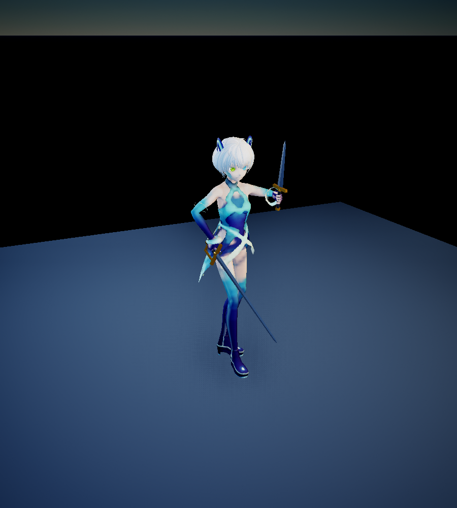
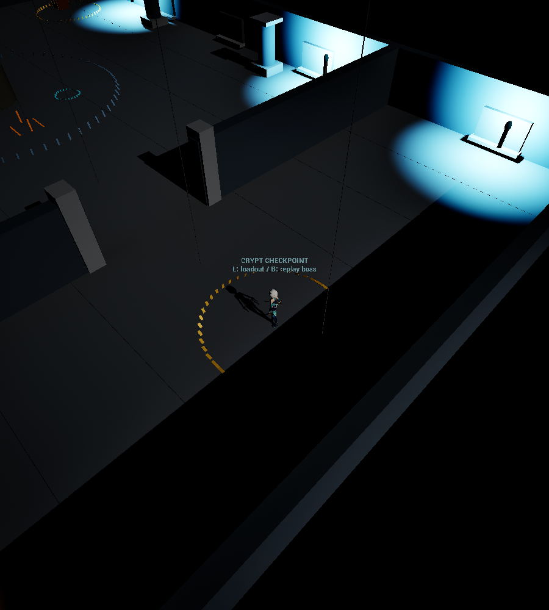

# Mistworld

A single-player, top-down action RPG combat prototype built in **Unreal Engine 5.8.3 with C++**. Mistworld explores characters with independently swappable base and ascension abilities, readable targeting, and a small dungeon progression loop.

This repository contains the current playable prototype and its implementation. It is early development: multiplayer, the overworld, guilds, raids, and ranked play are planned, and are not implemented here.



<details><summary>Crypt checkpoint preview</summary>



</details>

## What you can play

- **Two selectable heroes:** Alphonse, a greatsword fighter, and Anima, a rapier-and-dagger duelist. Each has four base abilities and four ascension alternatives; Q/W/E/R slots can be mixed independently.
- **Mouse navigation and held aiming:** click to move at constant speed, hold an ability to see its targeting outline, move while aiming, and release to cast. Committed windups lock movement.
- **Shared combat rules:** physical and magic damage, armor, shields, healing modifiers, damage-over-time attribution, crowd control, cooldowns, recasts, death, and spawn protection.
- **A crypt encounter:** three elemental guardians protect a golem boss. Fire uses area attacks, ice freezes on contact, and wind trades health for speed. The encounter includes telegraphs, an exposure phase, checkpoint respawn, and replay.
- **Local progression:** completion, checkpoints, a greatsword reward, hero-specific loadouts, and remaining cooldowns persist across restarts. Earlier save formats migrate to the current version.
- **Bright fantasy UI:** an ivory, blue, and gold combat dock, loadout menu, and inventory with an actual character preview and character-specific equipment slots.

Equipment is deliberately limited: the current crypt awards one Alphonse blade item that grants +5% ability damage. Other slots are present, but do not yet have an item pool. Ascension unlock buttons provide prototype test access rather than a completed ascension dungeon.

## Try it in Unreal

The current supported development target is **Windows, Unreal Engine 5.8.3**. Install Visual Studio's **Game development with C++** workload and the MSVC/Windows SDK components required by that engine installation. Install **Git LFS** before cloning so Unreal binary assets download correctly.

1. Clone the repository with Git LFS installed:

   ```powershell
   git clone https://github.com/Ahmazzez/MOBA-Quickplay.git
   cd MOBA-Quickplay
   git lfs pull
   ```
2. Right-click `Mistworld.uproject` and select **Generate Visual Studio project files**.
3. Open the generated solution and build **MistworldEditor / Development Editor / Win64**.
4. Open `Mistworld.uproject`. The startup map is `/Game/Mistworld/Maps/Lvl_CryptSlice`.
5. Press **Play**, then click the viewport for keyboard focus. `/Game/Mistworld/Maps/Lvl_CombatTest` is also available as a combat sandbox.

Unreal may compile shaders on the first launch. No account service or multiplayer backend is required. There is currently no packaged player download. The project currently enables the engine's editor MCP/toolset plugins for development; they can be disabled in the Plugins window if you only want to play. No external MCP server is needed to run the game.

### Controls

| Input | Action |
| --- | --- |
| Left click / hold left click | Move to the cursor destination |
| Hold Q / W / E / R, then release | Preview and cast the equipped ability |
| Space | Order repeated basic attacks; nearest enemy in reach, with cursor-hover target override |
| F | Flash toward the cursor; 60-second cooldown |
| Right click / Escape | Cancel aim and combat/movement orders |
| L | Hero and ability loadout menu at a safe checkpoint |
| I | Equipment inventory and character preview |
| C | Claim the reward chest after victory |
| B | Replay the boss encounter at a safe checkpoint |
| T / J / Y | Development helpers: spawn target / self-damage / reset attempt |

Switching heroes, loadouts, or equipment requires a safe checkpoint, no active encounter, and completion of the combat/effect lock. Menus do not pause enemies. Each hero retains their own health and cooldowns within the session; inactive cooldowns keep ticking.

## Code to review

| Area | Entry point |
| --- | --- |
| Input, targeting, cast lifecycle, and Alphonse combat | [MistworldPlayerController.cpp](Source/Mistworld/MistworldPlayerController.cpp) |
| Constant-speed navigation | [MistConstantSpeedPathFollowingComponent.cpp](Source/Mistworld/MistConstantSpeedPathFollowingComponent.cpp) |
| Shared damage, healing, statuses, and protection | [MistCombatHealth.cpp](Source/Mistworld/MistCombatHealth.cpp) |
| Anima's marks, parries, recasts, burns, and healing theft | [MistAnimaCombat.cpp](Source/Mistworld/MistAnimaCombat.cpp) |
| Dungeon encounter lifecycle | [MistCryptGolem.cpp](Source/Mistworld/MistCryptGolem.cpp), [MistCryptSession.cpp](Source/Mistworld/MistCryptSession.cpp) |
| Versioned save data and progression | [MistProgressionComponent.cpp](Source/Mistworld/MistProgressionComponent.cpp) |
| HUD and inventory preview | [MistCombatHUD.cpp](Source/Mistworld/MistCombatHUD.cpp), [MistInventoryPreview.cpp](Source/Mistworld/MistInventoryPreview.cpp) |

[Architecture notes](docs/ARCHITECTURE.md) describe the main boundaries and current constraints. The `Variant_Strategy` and `Variant_TwinStick` directories originate from Unreal's template; Mistworld's custom combat implementation is in the `Mist*` files and the top-down character/controller.

## Verification

The latest development snapshot built successfully and has **43 accepted Unreal automation checks**: 42 passed the full suite, and the updated presentation check passed its subsequent rerun. Coverage includes both heroes' kit combinations, targeting, constant-speed movement, save migration/failure handling, encounter behavior, and character switching across crypt sessions. Native Unreal renders separately checked imported character materials and poses. These checks do not validate networking or shipping performance.

To run the suite, build the editor target, then use Unreal's **Session Frontend → Automation** panel and select `Mistworld`, or run this PowerShell command from the repository root:

```powershell
$MistworldUnrealRoot = 'C:\Program Files\Epic Games\UE_5.8' # your engine directory
$MistworldProject = (Resolve-Path '.\Mistworld.uproject').Path
& "$MistworldUnrealRoot\Engine\Binaries\Win64\UnrealEditor-Cmd.exe" `
  $MistworldProject -unattended -nop4 -NullRHI -nosound `
  '-ExecCmds=Automation RunTests Mistworld' `
  '-TestExit=Automation Test Queue Empty' `
  "-ReportExportPath=$PWD\Saved\Automation\Portfolio"
```

Automation uses isolated test saves rather than the player's progression slot. Reports and personal saves are generated locally and are excluded from Git.

## Project context and credits

The project's character concepts, rules, visual direction, and iterative playtesting were developed by the project owner. **Implementation, test scaffolding, documentation, and parts of the placeholder art pipeline were developed with substantial AI coding assistance through Codex.** This portfolio presents that collaborative prototype and its source; it does not claim that every line or asset was authored unaided.

Art is provisional. Anima uses pixiv's Vita / VRoid `AvatarSample_F` model under CC0, with adapted rigging and weapon poses. Golem art and other external assets retain their own licenses and credits. Alphonse's current stylized blockout is placeholder art, and neither character represents final production art. Unreal template code and assets are governed by Epic's applicable terms. See [third-party notices](THIRD_PARTY_NOTICES.md) for the publication snapshot's asset sources and permissions.

Next development milestones are a small two-player combat/encounter test, additional heroes and dungeon content, then broader progression and world systems.
